<!-- sparkle-sign-warning:
IMPORTANT: This file was signed by Sparkle. Any modifications to this file requires updating signatures in appcasts that reference this file! This will involve re-running generate_appcast or sign_update.
-->

---

> **Note:** This is a personal fork built from source for my own daily use. I prefer having all features available without the subscription overhead — so this build reflects that. See the original project at [alt-tab.app](https://alt-tab.app/) to support the upstream author.

Download our build from [the latest fork release](https://github.com/Micuks/alt-tab-macos/releases/latest). Install the first update-enabled build manually once; after that, both automatic and manual update checks download this fork's signed update archives.

GitHub Actions checks official releases every six hours, merges them while preserving our patches, and publishes a universal macOS build. Conflicts stop publication for manual resolution. See [the release workflow specs](scripts/fork/ReleaseSpecs.md) for signing, versioning, and recovery details.
